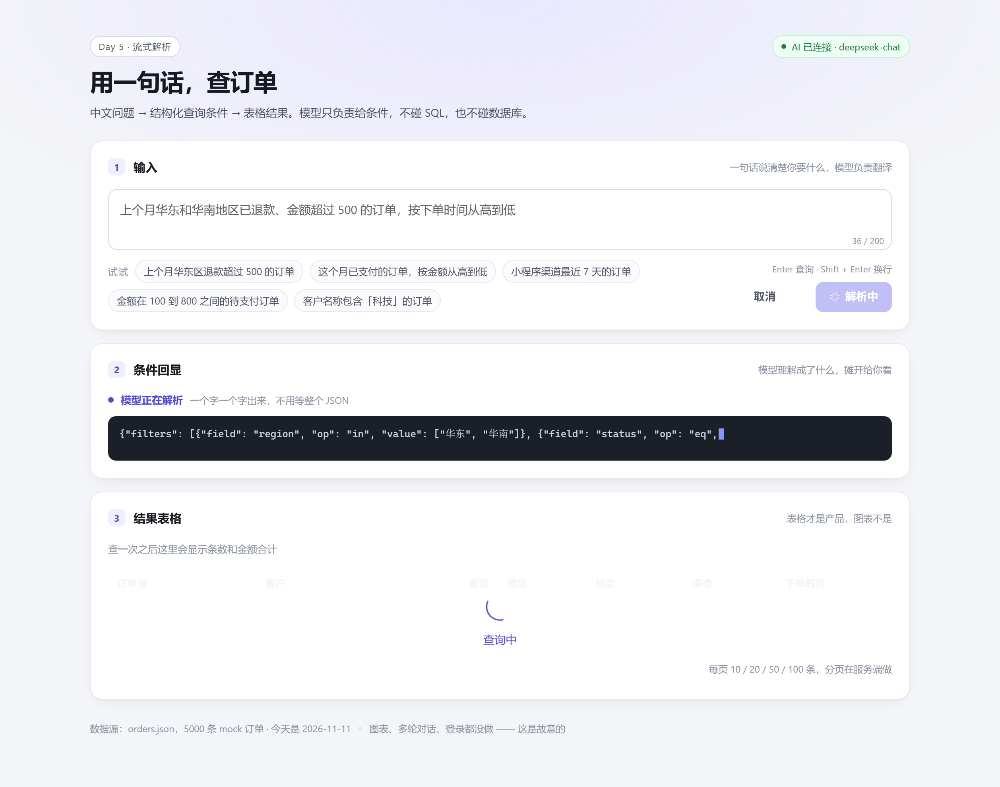
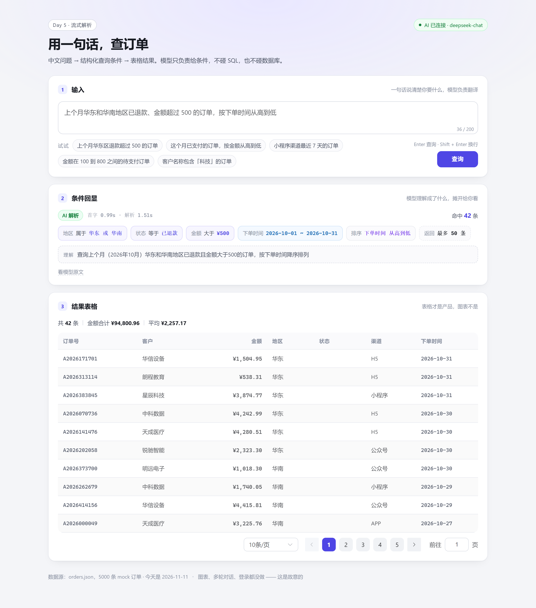
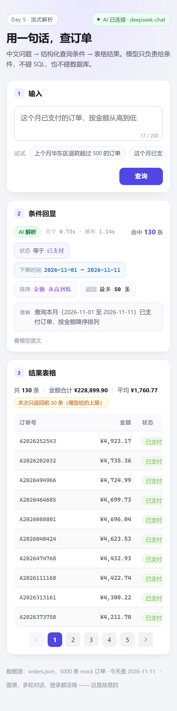
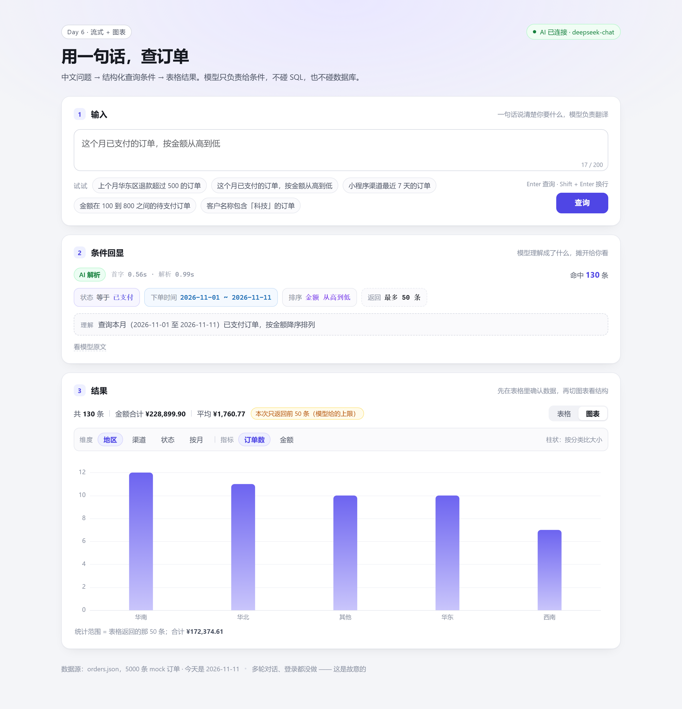
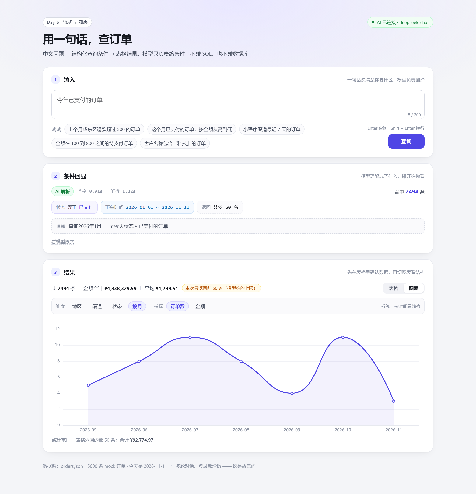
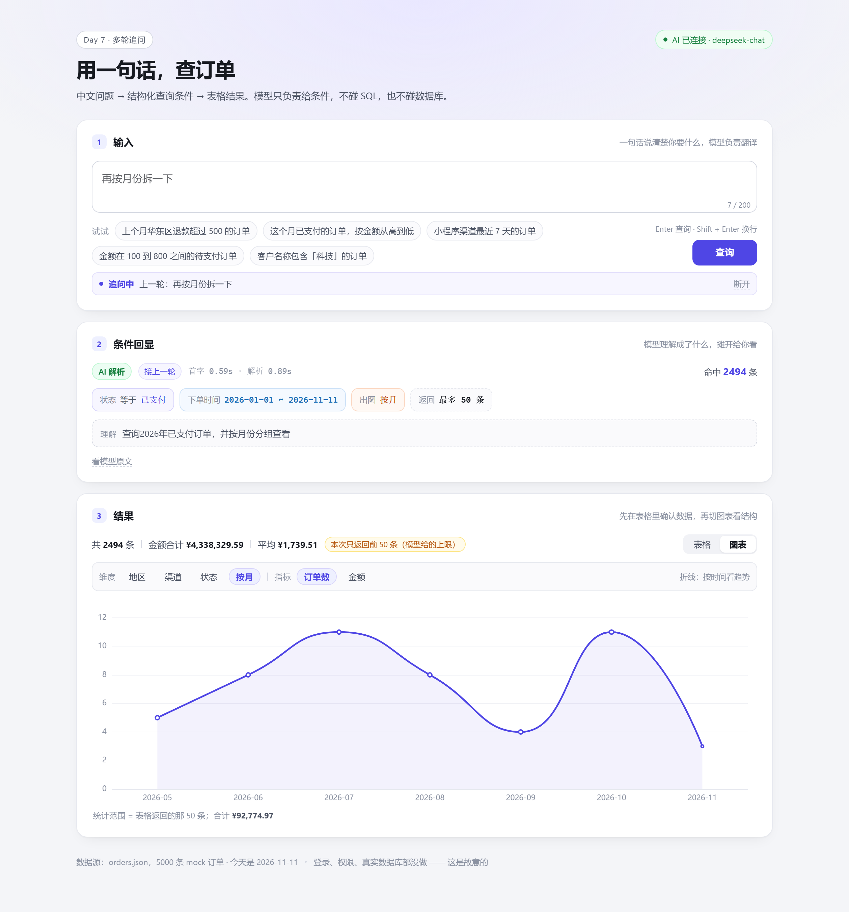
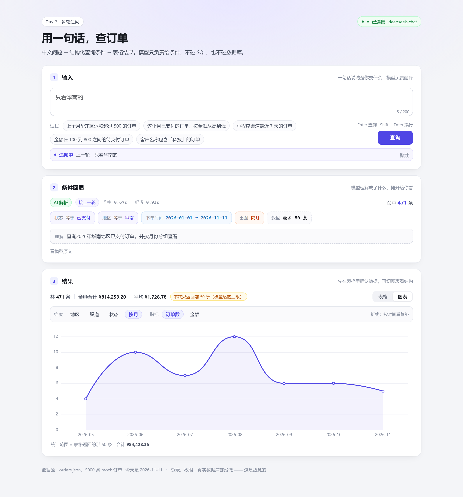
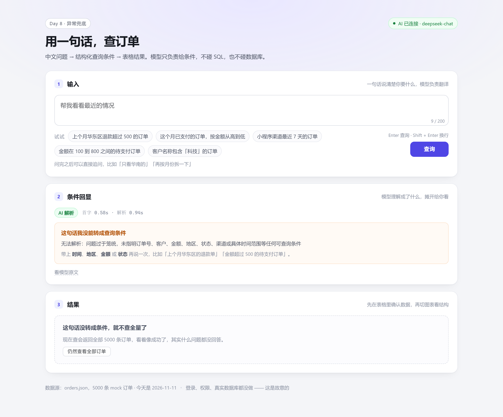

# AI 中后台 Demo · 起始包

这是两周计划的 **Day 1–2**，只做一件事：**验证「中文问题 → JSON 查询条件」跑不跑得通**。

不要在这一步写 UI。UI 是后面最不值钱、最不会出错的部分。

---

## 0. 前置（10 分钟）

1. Node 18 以上：`node -v`
2. 注册 https://platform.deepseek.com ，充 10 块钱（够你跑完整个项目）
3. 创建 API Key

---

## 1. Day 1：跑通 spike（30 分钟）

```powershell
cd ai-demo-starter
$env:DEEPSEEK_API_KEY="sk-你的key"
node spike.mjs
```

跑完会打印 10 个用例的通过情况和四个数字：**通过率、平均延迟、花费、结论**。

### 判断标准

| 通过率 | 结论 |
|---|---|
| ≥ 8/10 | 方法可行，进入 Day 2 |
| 6–7/10 | 调 prompt：把失败的 case 原样贴进 system prompt 当例子（few-shot） |
| ≤ 5/10 | 先别往下做。换模型试（deepseek-reasoner / 其他厂商），或者缩小字段范围 |

**这一步不通过就停下，不要用 UI 掩盖它。** 面试官问「模型输出不稳定怎么办」，你的答案就来自这里。

遇到失败时按顺序试：

1. 把失败用例写进 system prompt，作为 `问题 → 正确 JSON` 的示例（最有效）
2. 把枚举值写死得更明确，比如「地区只能是 华东/华北/华南/西南/其他，写其他算错」
3. `temperature` 已经是 0，别再调；改 `response_format` 和提示词更管用

---

## 2. Day 2：让查询真正跑出数据

```powershell
node gen-orders.mjs      # 生成 orders.json（5000 条）
```

然后写 `query.mjs`，做三件事：

1. 读 `orders.json`
2. 把 spike 产出的 JSON 条件翻译成数组过滤（`filters` + `dateFrom/dateTo` + `sort` + `limit`）
3. 打印前 10 条

**这一步的意义**：证明「AI 给的条件下，真的能查出业务数据」，而不是只拿到了一个 JSON。

> 已经写好了：`node query.mjs --ask "上个月华东区退款超过 500 的订单"`，不需要 Key，走本地规则解析。

```js
// query.mjs 的骨架
const opMap = {
  eq:  (a, b) => a === b,
  ne:  (a, b) => a !== b,
  gt:  (a, b) => a >  b,
  gte: (a, b) => a >= b,
  lt:  (a, b) => a <  b,
  lte: (a, b) => a <= b,
  in:  (a, b) => b.includes(a),
  like:(a, b) => String(a).includes(String(b)),
};
```

---

## 3. Day 3：搭 UI 骨架 ✅

页面只做三块：**输入框 → 条件回显 → 表格**。

```powershell
cd web
npm i
npm run dev          # 打开 http://localhost:5173
```

**不配 Key 也能跑。** 没配 `DEEPSEEK_API_KEY` 时会自动退回本地规则解析，页面右上角和条件回显里都会写明「规则兜底」，不会假装是模型算的。

想接真模型：

```powershell
Copy-Item web/.env.example web/.env.local
# 打开 web/.env.local，填 DEEPSEEK_API_KEY=sk-...
# 重启 npm run dev，右上角会变成「AI 已连接 · deepseek-chat」
```

### 3.1 这一版长什么样

```
┌─ 1 输入 ─────────── 一句话 + 5 个示例 chip，Enter 直接查 ─┐
├─ 2 条件回显 ─────── 条件 chip / 时间范围 / 排序 / 原话理解 ─┤
│                     右上角：来源（AI｜规则）＋ 解析耗时      │
│                     可展开：模型返回的原始 JSON             │
├─ 3 结果表格 ─────── 条数 / 金额合计 / 平均 + 服务端分页 ───┤
└──────────────────────────────────────────────────────┘
```

| 解析中（第一段条件先出来） | 查完之后 |
|---|---|
|  |  |

手机（390px）上自动收成三列，分页也只留翻页器：



### 3.2 几个决定，以及为什么

| 决定 | 为什么 |
|---|---|
| `/api` 挂在 Vite 插件上（`web/server/plugin.mjs`） | Day 3 只验证「一条链路通不通」，不值得为此再起一个进程、多一个端口 |
| 条件回显放在表格上面，还留了原始 JSON | 模型理解错了，用户当场能看见、能重问；而不是对着空表格怀疑人生 |
| 翻页把上一次的 `plan` 原样带回去 | 翻一次页不该再花一次模型调用（钱和延迟都省），第 2 页起 `source=replay` |
| 服务端分页 | 5000 条不进浏览器，条件留在服务端，只回 10 条 |
| 白名单字段 + 固定操作符解释执行 | 模型输出再离谱，也只可能「查错数据」，不可能变成一句 SQL |
| 规则兜底，且在页面上明示 | 没 Key 也能演示；但绝不把它说成 AI |

### 3.3 接口（就两个）

```http
GET  /api/meta    → { aiConfigured, model, today, totalOrders, fields, enums, examples }
POST /api/query   → { question, plan?, page?, pageSize? }
     ← { plan, rows, total, page, pageSize, pages, stats, source, warning, parseMs, queryMs }
```

`source` 只有三种值：`ai` / `rule` / `replay`。带了 `plan` 就不调模型，直接按条件查。

### 3.4 实测数字（deepseek-chat，2026-11-11）

| 指标 | 数值 |
|---|---|
| 通过率（10 个用例，与 spike 同一批） | **10/10** |
| 平均解析延迟 | 约 **0.87s**（单次 0.57–1.15s） |
| 10 次调用成本 | 输入 4391 token / 输出 718 token，约 **¥0.015** |
| 规则兜底解析延迟 | 0–1ms（同一批问题，结果集一致） |

调 prompt 的过程也留在这儿：第一次跑「订单号 A202611 的一笔订单」，模型给了 `op: eq`，而真实单号是 `A2026111151` 这种长度，`eq` 一定查不到。补了一条规则「只有值本身就是完整单号时才用 eq，否则用 like」，重跑变成 `like A202611`，命中 100 条。**这类问题不跑真实数据是发现不了的。**

### 3.5 自己跑一遍校验

```powershell
node query.mjs                                        # Day 2 的命令行版本
node query.mjs --ask "上个月华东区退款超过 500 的订单"   # 不需要 Key

cd web
npm test              # 规则解析的 12 个回归用例
npm run typecheck     # 类型检查
```

### 3.6 下一步

Day 3 到此为止，多轮 / 图表 / 登录都不在这一版里 —— 先让它能上线（见第 4 节）。

**先别做图表、别做多轮、别做登录。一个功能完整，比三个功能半成品强。**

---

## 4. Day 4：上线（Vercel）✅

Day 3 的 `/api` 只活在 Vite 的 dev server 里，`dist` 丢到任何静态托管上点查询就是 404。
Day 4 把它拆成「静态产物 + 真正的 Function」，而且本地就能验证这套组合。

### 4.1 本地跑生产包

```powershell
npm install
npm run build      # 构建 web/dist
npm start          # http://localhost:4173 —— 静态产物 + /api
```

`npm start` 用的是 `server.mjs`：托管 `web/dist`，`/api/*` 交给 `api/*.js` 这两个 handler ——
**和 Vercel 上跑的是同一份代码**，所以「本地行、线上不行」这类问题推之前就能撞见。

### 4.2 结构：三个入口，一份逻辑

```
api/meta.js   Vercel Function ┐
api/query.js  Vercel Function ├→ web/server/core.mjs  ← 全部业务逻辑
api/stream.js Vercel Function │     （解析 / 过滤 / 分页 / 限流）
server.mjs    本地 npm start   │
web/server/plugin.mjs  npm run dev ┘
                    └→ web/server/sse.mjs  ← 流式协议层
```

### 4.3 部署

```powershell
# 1) 这台机器还没装 git
winget install --id Git.Git -e --source winget

# 2) 首次提交
git init
git add .
git commit -m "Day 4: 可上线的订单查询 demo"

# 3) 推到 GitHub，在 Vercel 里 Import 这个仓库
#    Root Directory 保持仓库根，vercel.json 已经写好构建与函数配置
```

Vercel 项目设置里**必须加环境变量**（`.env.local` 不进 git，线上靠这里注入）：

| Key | Value |
|---|---|
| `DEEPSEEK_API_KEY` | 你的 key |

不加也能跑，但线上会退化成规则兜底，页面会明确写出来。CLI 方式：

```powershell
npm i -g vercel
vercel login
vercel env add DEEPSEEK_API_KEY production
vercel --prod
```

### 4.4 上线前踩掉/预判的四个坑

| 坑 | 处理 |
|---|---|
| `orders.json` 不会被自动打进 Function | `vercel.json` 的 `functions.includeFiles` 带上它；`core.mjs` 按 cwd 找，Vercel 上 cwd 是 `/var/task` |
| 从仓库根跑时读不到 `web/.env.local`，`aiConfigured` 变 false | 环境文件改成多锚点查找（cwd / web / 仓库根）。**这个是真撞出来的**：`npm start` 第一次探测就发现 key 没读到 |
| Hobby 计划函数 10s 上限，模型卡住会 504 | `parseWithAI` 超时收到 8s，超时即退回规则解析，用户照样拿到结果 |
| 接口公开 = 谁都能刷你的额度 | `core.mjs` 里加了进程内限流（默认 20 次/分钟/IP）。**它是尽力而为**：跨实例不生效，要真限流得接 Upstash Redis |

### 4.5 这一版验证过的

- `npm run build` → `web/dist` 1.33MB（gzip ≈ 375KB）
- `npm start` 后在浏览器里真点一次：`AI 解析 · 585ms`，命中 130 条、只返回前 50 条、分页 5 页
- 把 `api/` + `web/server/` + `orders.json` 单独拷到空目录（模拟 `/var/task` 的函数包）跑同一份 handler：meta / query / 400 / 405 全对
- `plan.limit` 和分页口径终于对齐：命中 130 条时表格显示「本次只返回前 50 条（模型给的上限）」，分页也只到 5 页

---

## 5. Day 5：流式解析（SSE）✅

把「点一下 → 转圈 0.9s → 结果一次性出现」换成「点一下 → 条件一个字一个字长出来 → 表格跟上」。
计划里那句「SSE 流式输出，首字响应 < 1s」，就是这一节。

### 5.1 事件协议

一个接口 `POST /api/stream`，四种事件，顺序固定：

| 事件 | 数据 | 页面上的表现 |
|---|---|---|
| `delta` | `{text}` | 条件回显区里逐字显示模型正在写的 JSON |
| `plan` | `{plan, source, warning, parseMs, firstTokenMs}` | chip 出现、耗时显示 |
| `rows` | 和 `/api/query` 完全一样的 payload | 表格填充 |
| `done` / `error` | `{}` / `{error}` | 结束 / 报错 |

翻页仍然走**非流式**的 `/api/query`（带 `plan` 回来）—— 没有东西可流，别为了一致性硬套。

### 5.2 两个必须踩的坑

- **SSE 必须按空行分帧**。我第一次按 chunk 切，一个事件跨两个 chunk 就把 JSON 截断了，字符丢失、解析必然失败。正确做法是攒 buffer，只认 `\n\n`。
- **取消要掐上游**。前端 abort → 服务端 `res.on('close')` → `AbortController.abort()` → 同时中止 DeepSeek 的 fetch。只断前端不断上游，等于取消了个寂寞，token 照烧。

### 5.3 实测（deepseek-chat）

| 指标 | 数值 |
|---|---|
| 首字到达 | **0.29–0.86s**，典型 0.5s |
| 整段（delta 收完 + 查表） | 0.6–1.3s |
| 非流式对照 | 0.59–0.90s（总数差不多，但用户要干等到最后） |
| 取消之后 | 300ms 断开，服务继续正常工作 |

计划里 Day 5 的验收点「首字响应 < 1s」达成。但说实话：**流式在这里的主要收益不是速度，是「看得见在干什么」+ 能取消。**

### 5.4 顺手补的移动端

- 390px 下表格只留 订单号 / 金额 / 状态 三列（`useMediaQuery` 控制列渲染 —— CSS 藏不掉 el-table 的列）
- 分页在窄屏只保留翻页器，隐藏「每页条数」和「前往 X 页」
- 示例 chip 改横向滑动，不再竖排占掉半屏
- 实测 `scrollWidth - innerWidth = 0`，没有横向溢出

---

## 6. Day 6：图表联动 ✅

「表格 + 一键图表」是计划里三个功能之二。这里的取舍只有一条：**图表和表格必须算同一批数据**。

| 分类维度（地区/渠道/状态） | 时间维度（按月） |
|---|---|
|  |  |

### 6.1 怎么联动的

- 结果卡片右上角 `表格 / 图表` 一键切换，不用等新请求
- **自动选维度**：挑一个用户还没在条件里筛过的（筛了地区就默认看渠道），全筛过才退回「按月」
- **自动选图型**：`month` → 折线（看趋势），分类 → 柱状（比大小），旁边直接写明为什么
- 指标可切「订单数 / 金额」

### 6.2 接口

```http
POST /api/summary   { plan, groupBy: "region"|"channel"|"status"|"month" }
     ← { groupBy, buckets: [{ key, count, amount }], total: { count, amount } }
```

纯内存计算，不调模型，所以不占限流额度。

### 6.3 一个必须守住的口径

`handleSummary` 里也执行了 `plan.limit` 的截断 —— 和表格返回的是**同一批行**。
不这么做就会出现「表格只返回 50 条、图表却统计了 2494 条」，用户一眼就看出是假的。
界面上也写清楚了：「统计范围 = 表格返回的那 50 条；合计 ¥92,774.97」。

### 6.4 踩到的坑

第一次截「按月折线」时，问的是「**这个月**已支付的订单」—— 结果折线图只有一个点，看起来像坏了。
不是 bug，是问法本身没有时间跨度。加了一句提示「这个范围只落在一个月里，拆不出趋势」，并把示例换成「今年已支付的订单」，7 个点才有趋势可看。

### 6.5 验证

- 4 个维度 × 2 个问题：各维度 `count` 求和 **等于**表格返回条数
- 金额求和与表格 `stats.sum` 一致（误差 < 0.01）
- `month` 的 key 格式 `YYYY-MM` 且升序
- 非法字段 / 非法维度 → 400
- 手机 390px 下图表不溢出，canvas 正常渲染

这些已经固化成 `web/server/summary.test.mjs`（7 条），`npm test` 会连着规则解析的 12 条一起跑。

---

## 7. Day 7：多轮追问 ✅

计划里三个功能边界的最后一个：「带上文，'再按月份拆一下'」。



### 7.1 只带「上一轮」，不做聊天记录

追问的本质是**改条件**，不是聊天。所以传的是上一轮的 `{ question, plan }`，
而不是把历史全塞进去：

- 稳定：上下文永远是「一个完整条件对象」，不会越滚越乱
- 省钱：prompt 长度固定，不随轮次增长
- 可控：页面上直接显示「追问中 · 上一轮：xxx」，随时能断开

### 7.2 prompt 怎么改

在原有 system prompt 后面追加：

```
这是多轮对话。上一轮：
用户问：「上个月华东区退款超过 500 的订单」
当时的条件：{...}

8. 保留上一轮里仍然成立的条件，只改这轮提到的部分；输出的是**完整的新条件**，不是补丁。
9. 用户说「去掉 / 不要 X」时，删掉对应的 filter 或时间范围。
10. 用户说「按 X 拆 / 按 X 看 / 看趋势 / 出个图」时，把 chart.groupBy 设成 region|channel|status|month，
    **不要**因此改动 filters。
11. 如果这轮明显是另起一个话题，忽略上文，按新问题正常解析。
```

第 10 条是这一轮真正的设计点：**追问既能改数据范围，也能改展示方式**。
为此给条件结构加了 `chart` 字段（只影响画图，不参与过滤），校验里同样管住白名单。

### 7.3 实测四轮（同一个会话）

| 追问 | 结果 |
|---|---|
| （首轮）上个月华东区退款超过 500 的订单 | 地区=华东、状态=已退款、金额>500、10 月 |
| 只看华南的 | 地区 华东 → **华南**，其余三项原样保留 |
| 把金额条件去掉 | 金额条件**消失**，地区/状态/时间保留 |
| 再按月份拆一下 | filters **一个字没动**，`chart.groupBy=month`，页面自动切到折线 |
| 按渠道看看今年已支付的 | 判定为另起话题：丢掉上文，状态=已支付、`chart.groupBy=channel` |



### 7.4 一个诚实的边界

规则兜底（没有 Key 时）**不做上文合并** —— 它只是关键词匹配，硬拼上文只会拼出怪东西。
遇到这种组合它会照常出结果，但警告条会写清楚：「规则兜底不支持合并上文，这条按单轮问题解析」。

**宁可少一个能力，也不能让用户以为模型记住了。**

---

## 8. Day 8–9：异常兜底 ✅

计划里这一天的原话：「异常场景：模糊表达、无结果、字段不存在、超时；补齐 loading/空态/错误态」。



### 8.1 先承认一个真问题

这一轮开工前我测了三个模糊提问，结果很糟：

| 提问 | 改之前 | 改之后 |
|---|---|---|
| 帮我看看最近的情况 | **返回 5000 条**，页面看起来像查成功了 | 引导态：说明没看懂 + 给建议问法 |
| 查一下毛利率超过 20 的订单 | **返回 5000 条** | 同上，并把「没有毛利率字段」这句话展示出来 |
| 利润最高的那个客户 | **返回 5000 条** | 同上 |

模型其实一直在 `reason` 里老实说「无法解析：……」，但这行字埋在条件回显里，用户看到的是**一张满满的表** —— 这是最坏的一种错：看起来成功了，其实什么也没回答。

### 8.2 判定规则

```js
// 没有任何条件（filters / 时间 / 排序 / 图表）时才算「没看懂」
const empty = !plan.filters.length && !plan.dateFrom && !plan.dateTo && !plan.sort && !plan.chart;
return /无法解析/.test(plan.reason) || source === 'rule';
```

- 模型明确说「无法解析」→ 没看懂
- 规则兜底一条都没解析出来 → 没看懂
- 模型正常返回空条件（用户真的问「全部订单」）→ **不算**没看懂，照常查

判定为「没看懂」之后，结果卡片**不再默认铺全量表**，改成一句说明 + 一个「仍然查看全部订单」的按钮。用户想看随时能看，但不能让他误以为提问成功了。

### 8.3 其余几种异常

| 场景 | 现在的表现 |
|---|---|
| 模型超时 | 8s 超时（`DEEPSEEK_TIMEOUT_MS` 可调）→ 自动规则兜底，提示「模型超过 8 秒没响应」，照常出结果 |
| 模型编字段 | 白名单拦截 → 提示「条件没通过校验：非法字段 profitRate」，退回规则解析 |
| 接口 5xx | 提示「模型接口报错」，不把 HTTP 细节和英文异常甩给用户 |
| 空问题 / 超长 | 直接 400，前端红条提示，不发请求 |
| 限流 | 429 + 「查得太快，每分钟最多 20 次」 |
| 无结果 | 表格空态：「没有匹配的订单，试试放宽条件，或者换个说法再问一次」 |

### 8.4 验证

- `web/server/robust.test.mjs`：**14 条**离线用例（白名单拦截 5 条、没看懂判定 4 条、错误文案 4 条、兜底补齐 1 条）
- 超时演练：把阈值压到 250ms，实测 263ms 返回、`source=rule`、警告是「模型超过 250 毫秒没响应」、结果照常出来
- 浏览器实测：模糊提问 → 引导态出现（1.1s）、表格被隐藏、点「仍然查看全部订单」能放行（10 行）
- `npm test` 现在跑 **12 + 14 + 7 = 33 条**

---

## 9. 目录约定

```
ai-demo-starter/
├─ api/                   # Vercel Functions：只做协议适配
│  ├─ meta.js             # GET  /api/meta
│  ├─ query.js            # POST /api/query（非流式：翻页用）
│  ├─ stream.js           # POST /api/stream（SSE：新问题用）
│  └─ summary.js          # POST /api/summary（图表汇总）
├─ server.mjs             # 本地跑生产包：npm start
├─ vercel.json            # 构建命令 / 输出目录 / 函数的 includeFiles
├─ package.json           # 根脚本：dev / build / start / test
├─ spike.mjs              # Day1 技术验证
├─ gen-orders.mjs         # Day2 数据生成
├─ orders.json            # 5000 条 mock（被 includeFiles 带进 Function）
├─ query.mjs              # Day2 命令行版
├─ docs/                  # 截图
└─ web/
   ├─ src/
   │  ├─ App.vue          # 三块骨架 + 流式状态机
   │  ├─ components/      # QueryBar / ConditionEcho / ResultView / OrderTable / SummaryChart
   │  ├─ api.ts           # /api/meta、/api/stream、/api/query、/api/summary
   │  ├─ types.ts         # 前后端共用契约
   │  ├─ useMediaQuery.ts # 窄屏少渲染几列
   │  └─ format.ts        # 字段名、操作符、金额格式
   └─ server/             # 纯 Node ESM，不进前端产物
      ├─ core.mjs         # 业务逻辑 + 限流 + 汇总（三个入口共用）
      ├─ sse.mjs          # SSE 协议层：分帧、取消、错误事件
      ├─ schema.mjs       # 字段白名单 + prompt + 校验（唯一真源）
      ├─ parser.mjs       # 中文 → JSON：模型优先（含流式）、规则兜底
      ├─ engine.mjs       # JSON → 数组过滤 + 分页
      ├─ plugin.mjs       # 把 core 挂到 Vite 上
      ├─ parser.test.mjs  # 12 条：中文 → 条件的回归
      ├─ robust.test.mjs  # 14 条：白名单拦截、没看懂判定、错误文案
      └─ summary.test.mjs # 7 条：图表汇总口径
```

---

## 10. 三个提醒

- **别让模型生成 SQL**。这是这个项目最重要的技术决策，也是面试必问点。
- **别先做登录/权限**。两周做不完，且不加分。
- **每天结束前跑一次 spike**。改完 prompt 就测，别靠感觉。

---

## 11. 两周后你应该有

- 一个在线地址（陌生人 30 秒能玩明白）
- GitHub 仓库 + README（截图 + 技术决策）
- 一段 2 分钟演示视频
- 简历上一条能撑住 5 分钟追问的项目描述
